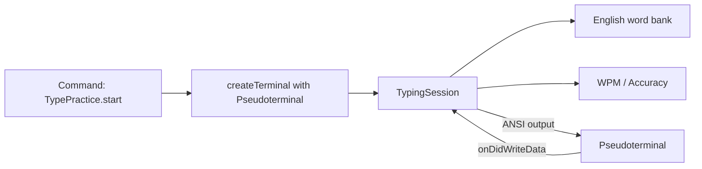

# Terminal 英文打字練習插件

## 目標

做一個 VS Code 擴充功能：透過指令開啟專用 Terminal，在裡面練習英文單詞／短句打字，並顯示速度與準確率。

## 技術選擇（已定）

- **UI**：VS Code [`Pseudoterminal`](https://code.visualstudio.com/api/references/vscode-api#Pseudoterminal)（看起來就是真正的 Terminal，由我們控制輸入輸出）
- **內容**：內建英文詞庫（常見單字 + 短句），隨機組句
- **MVP 模式**：固定字數（預設 25 words）；結束後顯示 WPM、準確率、錯誤數；可按鍵再來一局

不採用 Webview，也不做成一般 shell terminal 的 wrapper。

## 架構



核心流程：

1. 使用者執行指令 → 建立名為 `Type Practice` 的 Terminal
2. `TypingSession` 從詞庫抽 25 個字，組成一行目標文字
3. Pseudoterminal 用 ANSI 顯示目標與目前輸入狀態（正確綠、錯誤紅、游標位置）
4. 每個按鍵進入 session：比對、更新畫面、累計正確／錯誤與時間
5. 打完後輸出結果，按 `Enter` 再開一局、`Esc` 結束／關閉

## 專案結構

在空工作區 [`c:\Tool\VSCODEType`](c:\Tool\VSCODEType) 建立：

- [`package.json`](package.json) — extension 宣告、指令 `typePractice.start`、activationEvents
- [`tsconfig.json`](tsconfig.json)、[`esbuild` 或 `tsc` 編譯設定](tsconfig.json)
- [`src/extension.ts`](src/extension.ts) — activate / 註冊指令 / 建立 Terminal
- [`src/terminal/TypingPty.ts`](src/terminal/TypingPty.ts) — 實作 `vscode.Pseudoterminal`
- [`src/core/TypingSession.ts`](src/core/TypingSession.ts) — 狀態機：目標文字、游標、錯誤、計時、WPM
- [`src/data/words.ts`](src/data/words.ts) — 英文常見詞庫（約 200–400 字即可起步）
- [`README.md`](README.md) — 如何用 F5 啟動 Extension Development Host 測試

## MVP 行為細節

**顯示（類似 Monkeytype 的終端版）**

```
Type Practice — 25 words
────────────────────────────────
the quick brown fox jumps over ...
█
────────────────────────────────
WPM: --  Acc: --%  Progress: 0/25
```

輸入時即時重繪：已正確字元用綠色、錯誤用紅色底／紅色字、未打到的用暗色。

**統計**

- WPM = `(正確字元數 / 5) / 分鐘`
- Accuracy = `正確鍵擊 / 總鍵擊`
- 第一個有效按鍵才開始計時

**按鍵**

- 一般字元：比對並前進（錯誤仍前進，但記錯；或採「必須打對才前進」——MVP 採常見的 **允許錯誤前進並標紅**）
- `Backspace`：回退
- `Ctrl+R` / 打完後 `Enter`：重開一局
- `Esc`：結束 session

## 實作步驟

1. 用 TypeScript 初始化 VS Code extension 骨架（`package.json`、`tsconfig`、編譯腳本）
2. 實作詞庫與組句邏輯
3. 實作 `TypingSession`（純邏輯，方便之後加測試）
4. 實作 `TypingPty`：ANSI 清屏／游標／上色、把 key data 餵給 session
5. 在 `extension.ts` 註冊指令並 `createTerminal({ name, pty })` 後 `show()`
6. 本地用 F5 / `vscode:prelaunch` 驗證完整一局流程

## 刻意不做（第一版）

- 中文／程式碼模式
- 帳號、線上排行榜、歷史圖表持久化
- 自訂主題以外的花俏 UI（僅用 Terminal ANSI + 跟隨終端字型）
- 多語言設定頁（之後可用 `contributes.configuration` 加字數、難度）

## 驗證方式

- `npm install` → `npm run compile`
- VS Code 開此資料夾 → F5 開 Extension Development Host
- Command Palette 執行 `Type Practice: Start`
- 打完一局，確認 WPM／準確率合理，且可再開一局
